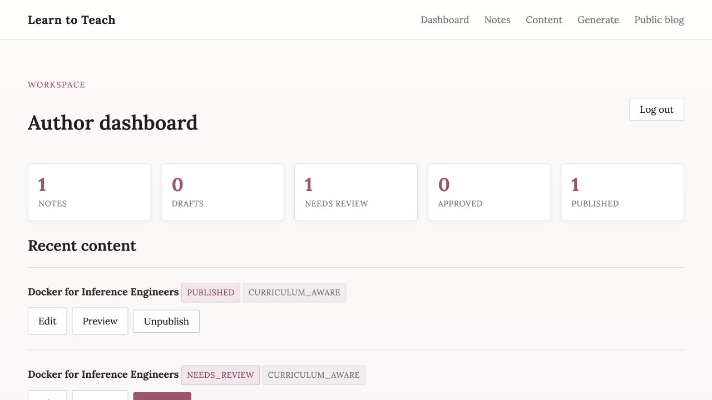
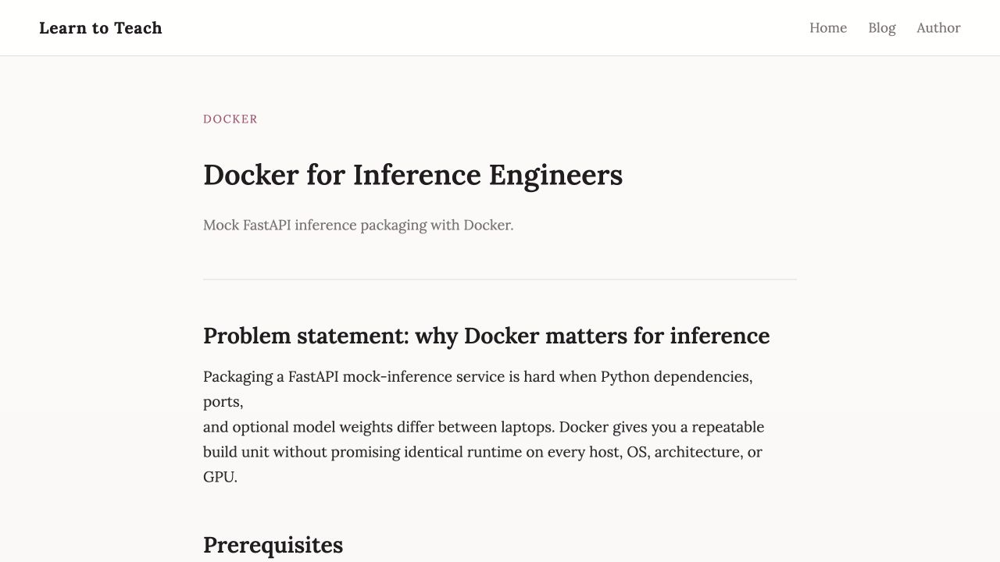
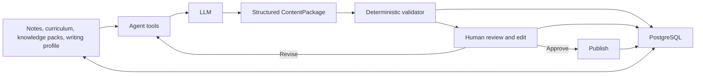

# Learn to Teach Agent

AI-assisted technical teaching platform that turns a learning topic, optional notes, and a saved curriculum into a beginner-friendly article, teaching example, interactive quiz, and publication-readiness report — then hosts the published blog on the same FastAPI app.

> **In one sentence:** this is a human-reviewed content pipeline, not a chat interface: it gathers grounded context, produces typed output, runs deterministic checks, and requires approval before publishing.

## Product problem

Engineers learning a long path (FastAPI → Docker → Kubernetes → LLM inference → vLLM → RAG → Prometheus/Grafana) accumulate notes that rarely become durable teaching artifacts. Generic LLM wrappers invent personal war stories, fake metrics, and ungrounded commands. This project treats generation as a **reviewable draft pipeline** with curriculum tools, deterministic validation, manual approval, and self-hosted publishing.

## Why this is not just an AI text wrapper

- Real LangChain 1.x agent via `create_agent` with tools that load learning path, notes, knowledge packs, and writing profile
- Two generation modes: **notes-grounded** vs **curriculum-aware**
- Deterministic validation after structured output (quiz schema, first-person claims, fabricated metrics, sources)
- Content lifecycle: `needs_review` → `approved` → `published` (no auto-publish)
- Self-hosted public blog + private author dashboard (not Medium/Substack/WordPress)
- Notes stored in PostgreSQL, not only on the container filesystem

## Product demo

| Human review before publication | Published teaching experience |
|---|---|
|  |  |

The private workflow preserves model/provider and prompt-version metadata, surfaces validation results, and exposes explicit edit/approve/publish actions. Only published items appear on the public blog. These screenshots are from the running application with deterministic demo content, so reproducing the UI does not require a paid model call.

## Architecture



The FastAPI application serves both surfaces: a session-protected author dashboard under `/admin/*` and the public blog, article, and quiz routes. PostgreSQL stores notes, generated packages, validation results, lifecycle state, and publication metadata.

### Agent tool flow

1. Agent receives topic + optional notes.
2. System prompt requires calling context tools before drafting.
3. Tools return curriculum/notes/knowledge/profile as **untrusted data**.
4. Agent returns `ContentPackage` via `response_format=ContentPackage`.
5. Validation layer records warnings and blocks invalid quiz/source schemas.
6. App persists status `needs_review` for human edit/approve/publish.

### Notes-grounded vs curriculum-aware

| Mode | When | Behavior |
|------|------|----------|
| `notes_grounded` | Meaningful notes present | May use author's stated observations; must not invent extra personal experiences |
| `curriculum_aware` | Notes missing/weak | Neutral article from learning path + knowledge pack + writing profile; no fabricated "I debugged…" stories; hypotheticals use Imagine/Suppose/Consider |

## Prompt-engineering design

Prompts live under `prompts/` with version, role, goal, context/source/personal-experience policies, teaching/voice requirements, output contract, failure behavior, and self-check. Notes/knowledge files cannot override the system prompt. See `prompts/README.md`.

## Local development

### Prerequisites

- Python 3.12
- Docker / Docker Compose
- Optional: kubectl for manifest dry-run validation

### Setup

```bash
cp .env.example .env
# Set OPENAI_API_KEY or ANTHROPIC_API_KEY, ADMIN_USERNAME, ADMIN_PASSWORD_HASH, SESSION_SECRET
# For Compose .env files, escape each bcrypt $ as $$
python3 -m venv .venv
source .venv/bin/activate
make install
```

Generate an admin password hash:

```bash
python -c "import bcrypt; print(bcrypt.hashpw(b'YOUR_PASSWORD', bcrypt.gensalt()).decode().replace('\$','\$\$'))"
```

Store the plaintext password only in a local secret manager or `.admin_credentials.local` (gitignored). Never commit `admin` / `changeme` defaults for a running environment.

### Run tests and lint

```bash
make lint
make test
```

All LLM-dependent tests mock the model. CI does not require API keys.

### Run with Docker Compose

```bash
cp .env.example .env
# optionally set OPENAI_API_KEY or ANTHROPIC_API_KEY + LLM_PROVIDER
make up
make smoke
```

Compose starts:

- `db` — PostgreSQL 16 with named volume `pgdata` and `pg_isready` health check
- `app` — FastAPI/Uvicorn on `8000`, waits for healthy DB, loads `.env`

### Persistence check (documented procedure)

1. Log into `/admin`, create a note and a draft (or insert via tests).
2. Recreate only the app container: `docker compose up -d --force-recreate --no-deps app`
3. Confirm the note and draft still exist in `/admin` (data lives in the Postgres volume).

## API usage example

```bash
# The JSON API uses the same authenticated admin session as the HTML UI.
# Replace the placeholders with the credentials configured in .env.
curl -c lta.cookies -X POST http://localhost:8000/admin/login \
  -H 'Content-Type: application/x-www-form-urlencoded' \
  --data-urlencode 'username=YOUR_ADMIN_USERNAME' \
  --data-urlencode 'password=YOUR_ADMIN_PASSWORD'

curl -b lta.cookies -X POST http://localhost:8000/api/v1/content/generate \
  -H 'Content-Type: application/json' \
  -d '{
    "topic": "Docker",
    "notes": "",
    "audience": "engineers preparing for production LLM inference",
    "content_type": "tutorial",
    "tone": "clear, practical, beginner-friendly",
    "desired_length": "medium",
    "include_quiz": true
  }'
```

Health (no LLM call):

- `GET /health/live`
- `GET /health/ready` — DB + config only

## Docker

Multi-stage-style slim Python 3.12 image:

- Dependency layer caching via `requirements.txt`
- Non-root user `appuser` (uid 10001)
- No API keys baked into the image
- Port 8000, Uvicorn, container health check
- `.dockerignore` excludes `.env` and tests

## Kubernetes (educational / local cluster)

Manifests under `k8s/`:

| Resource | Purpose |
|----------|---------|
| `namespace.yaml` | Isolate resources |
| `app-configmap.yaml` | Non-secret config |
| `app-secret.example.yaml` | Placeholder secrets only |
| `app-deployment.yaml` | 2 replicas, probes, resources, non-root |
| `app-service.yaml` | ClusterIP port 80 → 8000 |
| `dev-postgres.yaml` | Dev-only Postgres + PVC |

Validate client-side:

```bash
make k8s-validate
```

Local cluster sketch (Docker Desktop / Minikube / Kind):

1. Build image: `docker build -t learn-to-teach-agent:local .`
2. Copy `app-secret.example.yaml` → `app-secret.yaml`, fill placeholders
3. `kubectl apply -f k8s/namespace.yaml -f k8s/dev-postgres.yaml -f k8s/app-configmap.yaml -f k8s/app-secret.yaml -f k8s/app-deployment.yaml -f k8s/app-service.yaml`

**Not claimed:** this repository's verification did not deploy to a live Kubernetes cluster unless separately performed. Production should use managed PostgreSQL, not `dev-postgres.yaml`.

## Domain / hosting outline

1. Deploy the Dockerized app behind a reverse proxy.
2. Set `PUBLIC_BASE_URL` to your public origin.
3. Add a custom domain at your host.
4. Create DNS CNAME or A record.
5. Terminate HTTPS at the proxy/load balancer.
6. Verify published articles at `/blog/{slug}`.

Domain configuration is **not** claimed completed in this project verification.

## Database note

MVP creates tables with SQLAlchemy `create_all` on startup. Alembic migrations are a recommended production improvement.

## Known limitations and next steps

- **Evals:** `evals/content_cases.json` is an initial case set, not yet a scored regression harness. Add rubric-based quality, grounding, and safety evals to CI.
- **Observability:** add structured request traces, agent/tool-call visibility, validation metrics, and alerting. Do not log note contents or secrets by default.
- **Background jobs:** generation currently runs in the request path. Move long-running work to a durable queue with status updates, cancellation, and retry policy.
- **Authentication and RBAC:** the MVP has one bcrypt-authenticated admin session. Replace it with a managed identity provider, CSRF protection, HTTPS-only cookies, and author/reviewer/publisher roles.
- **Managed data layer:** production should use managed PostgreSQL, migrations, backups, connection pooling, and object storage for uploads; local startup currently uses `create_all`.
- **Cost and latency tracking:** persist per-generation timing, token usage, model/provider, retry count, and estimated cost; expose budgets without storing sensitive prompts unnecessarily.
- **Model quality:** deterministic validation catches known claim and schema problems, but it cannot prove factual correctness. Human review remains mandatory, and the local knowledge packs are intentionally incomplete.

## Verification

The repository separates fast, key-free checks from the container smoke test:

**Latest local verification (August 8, 2026):** Ruff passed, all 64 tests passed, the Docker image built successfully, PostgreSQL reached `healthy`, and the runtime smoke test passed all three HTTP checks.

| Check | Command | Coverage |
|---|---|---|
| Lint | `make lint` | Ruff over application and tests |
| Unit/integration tests | `make test` | 64 tests; LLM calls mocked; auth, tools, modes, validation, publishing, uploads, and health routes |
| Compose validation | `docker compose config --quiet` | Compose file and environment interpolation |
| Runtime smoke test | `make up && make smoke` | App/database containers plus live, ready, and home HTTP checks |
| Kubernetes syntax | `make k8s-validate` | Client-side manifest validation when `kubectl` and a reachable API server are available; otherwise reports an explicit skip |

GitHub Actions repeats lint and tests on every pull request and builds the Docker image. A local smoke test still requires Docker Desktop or another running Docker daemon.

## Résumé-ready description

Built a FastAPI + LangChain portfolio platform that generates curriculum-aware technical teaching content with tool-grounded context, deterministic safety validation, PostgreSQL-backed drafts/notes, interactive quizzes, and a self-hosted publish workflow packaged with Docker Compose and educational Kubernetes manifests.

For a concise discussion of the decisions, tradeoffs, and changes I would make today, see [`docs/project-writeup.md`](docs/project-writeup.md).

## Interview talking points

1. Why `create_agent` + tools beats a single LLM call for grounded teaching content
2. How notes-grounded vs curriculum-aware prevents fabricated experience claims
3. Why validation is deterministic and separate from the model
4. Content lifecycle and why auto-publish is unsafe
5. How Compose health checks and named volumes demonstrate real ops basics
6. What would change for production (migrations, managed DB, IdP, secrets)

## Exact next commands for a real LLM generation

```bash
cp .env.example .env
# Edit .env: set LLM_PROVIDER, MODEL_NAME, and the matching API key
make up
# Open http://localhost:8000/admin/login with your configured admin credentials
# Create or select notes → Generate → Edit → Approve → Publish
# Visit http://localhost:8000/blog/{slug}
```
